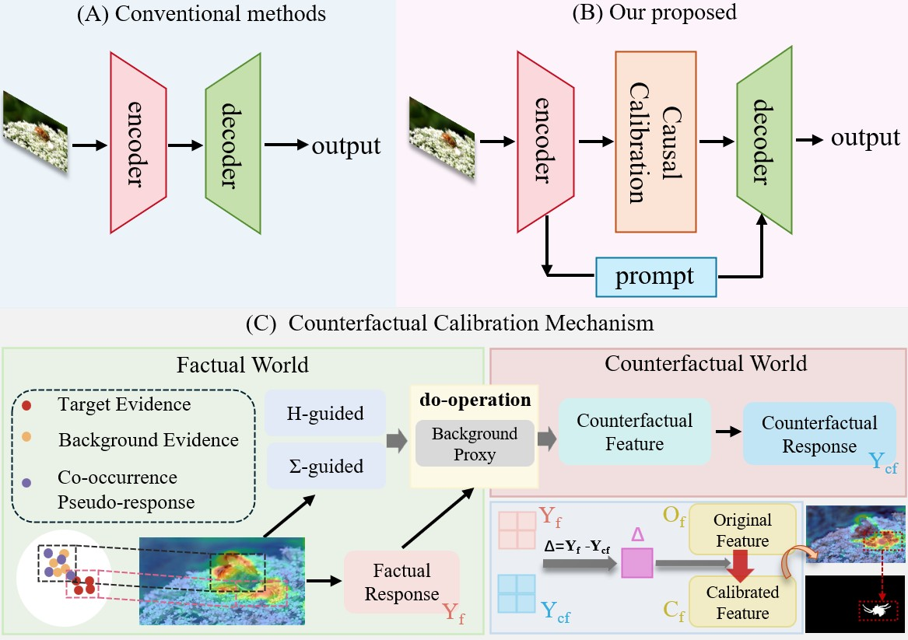
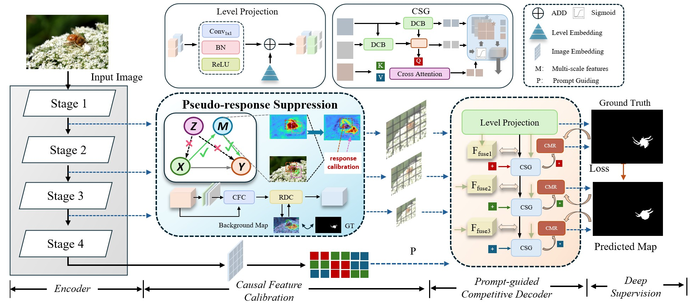
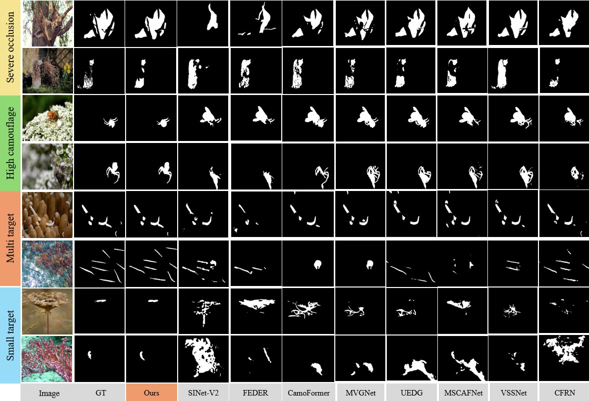
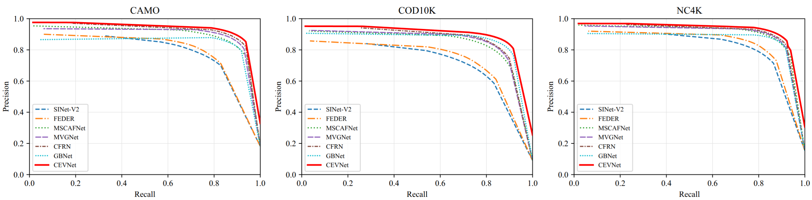
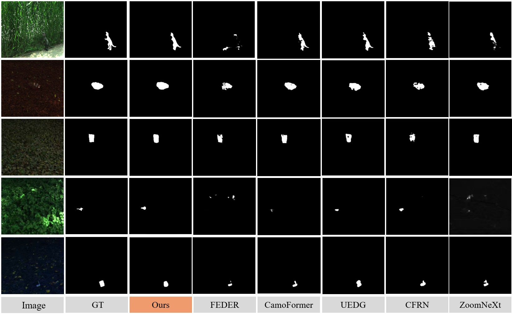
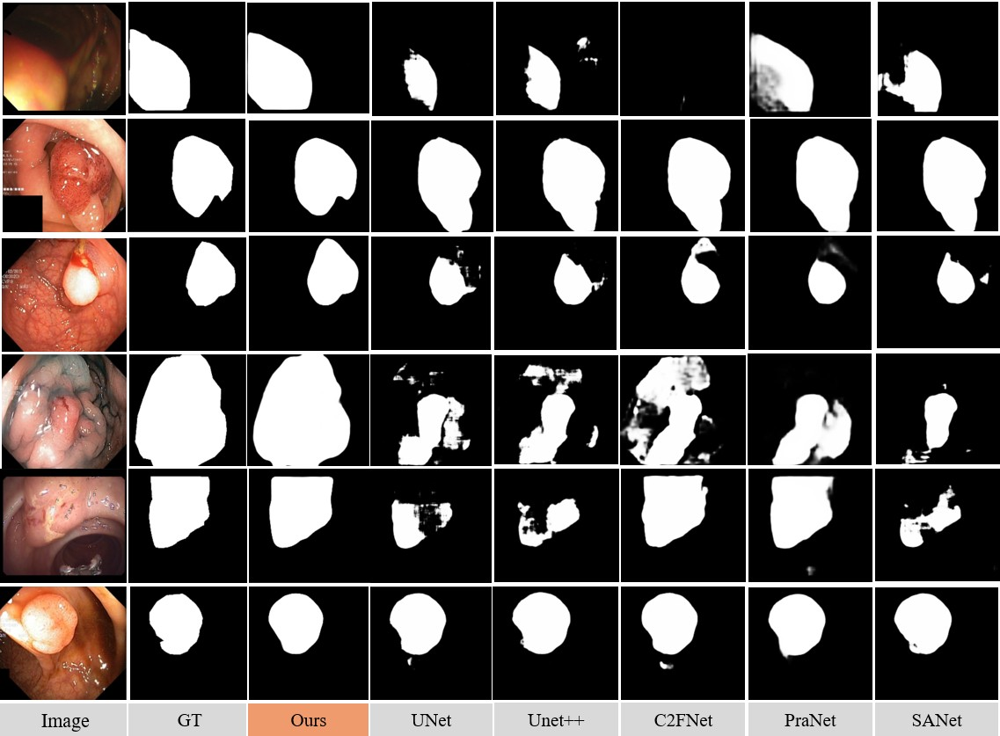
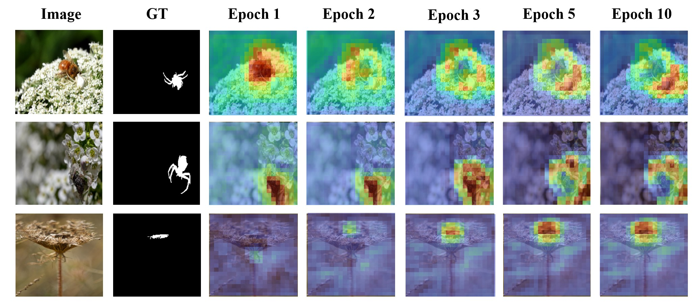
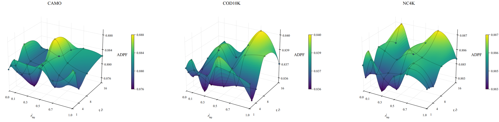

# CEVNet

### Counterfactual Evidence Calibration and Prompt-Guided Competitive Decoding for Camouflaged Object Detection

This repository is the **official project page** for **CEVNet**, a framework for camouflaged object detection (COD). CEVNet aims to distinguish reliable foreground evidence from background-induced responses through counterfactual feature calibration and prompt-guided competitive decoding.

> **Release status:** Project figures and experimental summaries are available. Source code, pretrained weights, and reproduction instructions will be released in a future update.

## Overview

CEVNet addresses background-induced false responses in camouflaged object detection by calibrating candidate features with counterfactual evidence and refining predictions through semantic guidance.

<p align="center">
  
</p>

## Framework

<p align="center">
  
</p>

CEVNet integrates **Counterfactual Evidence Calibration** (CFC and RDC) to suppress background-sensitive responses with **Prompt-Guided Competitive Decoding** (CSG and CMR) to improve multi-scale fusion and mask refinement. Calibration operates on the first three encoder stages; the fourth stage supplies semantic prompts.

## Results on COD Benchmarks

We evaluate CEVNet on three widely used camouflaged object detection benchmarks: **CAMO**, **COD10K**, and **NC4K**. The following results correspond to **CEVNet with a PVTv2-B4 backbone** at an input resolution of **384 × 384**.

| Dataset | S-measure ↑ | E-measure ↑ | Adaptive F-measure ↑ | MAE ↓ |
|:--|--:|--:|--:|--:|
| CAMO | **0.885** | **0.946** | **0.871** | **0.037** |
| COD10K | **0.872** | **0.948** | **0.818** | **0.020** |
| NC4K | **0.898** | **0.947** | **0.873** | **0.027** |

In the comparisons reported in our manuscript, this configuration obtains the best results across all twelve metrics among the evaluated methods. Additional backbone experiments include PVTv2-B2 and Res2Net-50 variants.

### Qualitative Comparisons



### Precision–Recall Curves



## Evaluation Beyond Standard COD Benchmarks

### HyperCOD Pseudo-RGB Images

To examine performance in highly camouflaged natural scenes with small foreground regions and complex backgrounds, we evaluate CEVNet on **HyperCOD pseudo-RGB images**. This experiment uses **three-channel pseudo-RGB representations**, not the full hyperspectral data cube.

| S-measure ↑ | E-measure ↑ | Adaptive F-measure ↑ | MAE ↓ |
|--:|--:|--:|--:|
| **0.772** | **0.909** | **0.673** | **0.002155** |



### Polyp Segmentation

We also evaluate the framework on **CVC-300**, **CVC-ClinicDB**, **CVC-ColonDB**, **ETIS-Larib**, and **Kvasir** to study its applicability to a different segmentation task. Training uses Kvasir and CVC-ClinicDB; the other three datasets provide cross-dataset evaluation. In the comparisons reported in the manuscript, CEVNet achieves the best or tied-best results on **17 of 20** evaluated metrics.



## Additional Visualizations

### Evolution of Prediction Responses

Intermediate responses progressively concentrate on object regions during training.



### Hyperparameter Sensitivity

The following visualization illustrates the joint effects of the auxiliary attention supervision weight and the low-rank calibration subspace rank.



## Repository Structure

```text
CEVNet/
├── README.md
└── figures/
    ├── README.md
    ├── motivation.jpg
    ├── overall.jpg
    ├── visualization.jpg
    ├── pr_curves.jpg
    ├── visualization2.jpg
    ├── visualization3.jpg
    ├── visualization4.jpg
    └── hyperparameter_surface.jpg
```

## Code and Model Availability

The repository currently provides the project description and figures. **Training code, inference scripts, pretrained checkpoints, and setup instructions are not yet available** and will be added in a later release.

## Citation

Citation information will be provided when the manuscript becomes publicly available.
